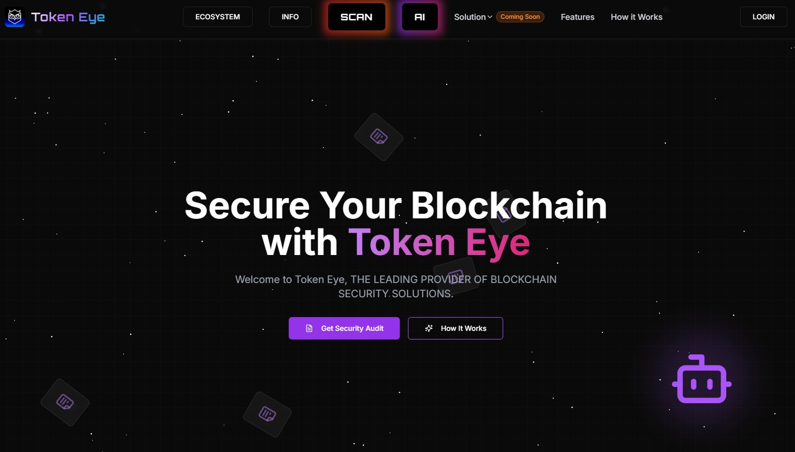
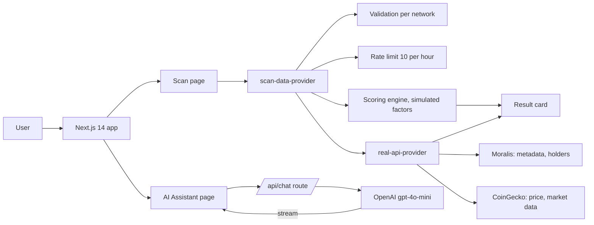
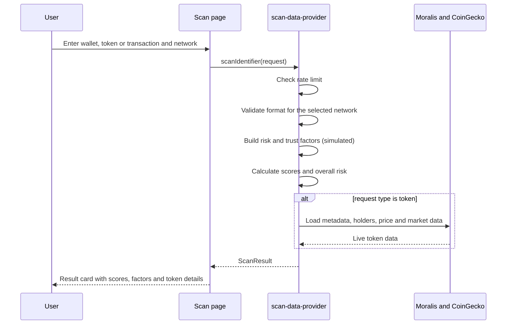

# Token EYE



A web interface for checking the risk of blockchain wallets, tokens and transactions, with a built-in AI security assistant.

> **Status: prototype.** Token details (metadata, price, market cap, supply, holders) come from live APIs. Risk and trust factors, the scores built from them, and wallet and transaction scans are still simulated. Do not use the results for compliance decisions.

## Features

- **Scan page:** check a wallet, token or transaction on 7 networks: Ethereum, BNB Smart Chain, Polygon, Avalanche, Arbitrum, Optimism and Cardano.
- **Live token data:** for tokens on six EVM networks the app loads metadata and top holders from [Moralis](https://moralis.io/), and price, market cap, volume and supply from [CoinGecko](https://www.coingecko.com/).
- **Input validation:** address and hash formats are checked per network before a scan starts.
- **Risk and trust scoring:** each result has a risk score, a trust score and an overall level (low, medium, high) with the factors behind it (simulated for now).
- **Rate limiting:** 10 scans per hour per client.
- **AI security assistant:** streaming chat on the OpenAI API (`gpt-4o-mini`) for smart-contract security, AML and compliance questions. It answers in Russian or English, matching the user.
- **Installable PWA:** web manifest and service worker.
- **Responsive UI:** Tailwind CSS, shadcn/ui and Radix components, Framer Motion animations, Recharts.

## Architecture



## Scan flow



## Scoring model

| Level | Risk score |
| --- | --- |
| High | 70 and above |
| Medium | 40 to 69 |
| Low | below 40 |

Risk factors add 30 (high), 20 (medium) or 10 (low) points, capped at 100. Trust factors add points the same way and are also capped at 100.

## Tech stack

Next.js 14, React 18, TypeScript, Tailwind CSS, shadcn/ui, Radix UI, Framer Motion, Recharts, Zod, React Hook Form, OpenAI SDK, Moralis API, CoinGecko API.

## Getting started

```shell
pnpm install
pnpm dev
```

Open `http://localhost:3000`.

API keys (OpenAI, Moralis, CoinGecko) must be set in your own environment. Never commit real keys to the repository.

## Roadmap

- Replace simulated risk factors with real data: block explorer APIs, on-chain RPC and sanctions lists.
- Add live wallet and transaction analysis.
- Move all API calls to server-side routes and read keys from environment variables.
- Server-side rate limiting.
- Add tests for validation and scoring.

## Author

Ioannes Avakian, senior software engineer (full-stack, distributed systems, blockchain).
Contact: masterofscience1993@gmail.com
