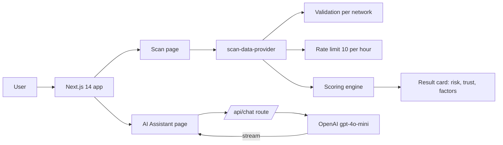
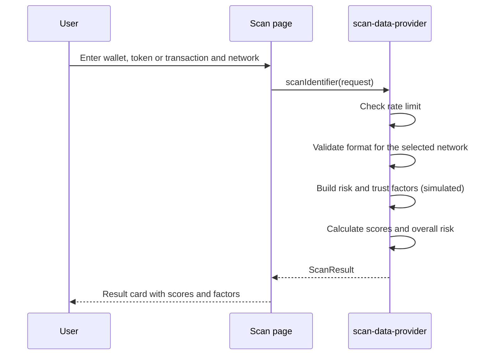

# Token EYE

A web interface for checking the risk of blockchain wallets, tokens and transactions, with a built-in AI security assistant.

> **Status: prototype.** Scan results are simulated. The app validates input and shows the full result flow, but it does not query blockchain data yet. Do not use it for compliance decisions.

## Features

- **Scan page:** check a wallet, token or transaction on 7 networks: Ethereum, BNB Smart Chain, Polygon, Avalanche, Arbitrum, Optimism and Cardano.
- **Input validation:** address and hash formats are checked per network before a scan starts.
- **Risk and trust scoring:** each result has a risk score, a trust score and an overall level (low, medium, high) with the factors behind it.
- **Rate limiting:** 10 scans per hour per client.
- **AI security assistant:** streaming chat on the OpenAI API (`gpt-4o-mini`) for smart-contract security, AML and compliance questions. It answers in Russian or English, matching the user.
- **Installable PWA:** web manifest and service worker.
- **Responsive UI:** Tailwind CSS, shadcn/ui and Radix components, Framer Motion animations, Recharts.

## Architecture



## Scan flow



## Scoring model

| Level | Risk score |
| --- | --- |
| High | 70 and above |
| Medium | 40 to 69 |
| Low | below 40 |

Risk factors add 30 (high), 20 (medium) or 10 (low) points, capped at 100. Trust factors add points the same way and are also capped at 100.

## Tech stack

Next.js 14, React 18, TypeScript, Tailwind CSS, shadcn/ui, Radix UI, Framer Motion, Recharts, Zod, React Hook Form, OpenAI SDK.

## Getting started

```shell
pnpm install
pnpm dev
```

Open `http://localhost:3000`.

For the AI assistant, set your OpenAI API key in `app/api/chat/route.ts`. Never commit a real key to the repository. Moving it to an environment variable is on the roadmap.

## Roadmap

- Replace simulated results with real data: block explorer APIs, on-chain RPC and sanctions lists.
- Server-side rate limiting.
- Read the OpenAI key from an environment variable.
- Add tests for validation and scoring.

## Author

Ioannes Avakian, senior software engineer (full-stack, distributed systems, blockchain).
Contact: masterofscience1993@gmail.com
